# Color schemes

Machinon's colors come in themes. Each built-in theme has a light and a dark version, and you
choose both the theme and when to use which version: always light, always dark, or following
the light/dark setting of the phone, tablet or computer you are looking at. You can also build
and save themes of your own. Everything lives on the Theme Hub's **Colors and schemes** tab.

## Picking a theme and a mode

Open the Theme Hub (see [Theme Hub](theme-hub.md) if you haven't yet) and go to **Colors and
schemes**. Each theme is shown as one card: a name, a short description, and a preview of both
versions side by side. The version this device is showing is at full strength and the other one
is dimmed, and the selected card has a bar under the version on screen. Click a card to use that
theme.

Above the cards, a three-way switch sets the mode:

| Mode | What you see |
| --- | --- |
| **Light** | Always the theme's light version. |
| **Dark** | Always the theme's dark version. |
| **Follow device** | The version that matches the light or dark setting of the device you are using. When that setting changes, for example when your phone switches to dark in the evening, Machinon follows straight away, without a reload. |

In Follow device, a line under the switch tells you which version this device is getting and
why, for example "This device is in dark mode, so you see the dark version."

Every choice takes effect immediately and is saved right away; there is no separate Apply or
Save step. The theme and the mode are personal settings: on an installation with separate
logins they apply only to your own account, and other users keep their own. See [Theme
Hub](theme-hub.md#personal-settings-versus-shared-settings) for how personal settings work if
your installation has no separate logins. Even when everyone shares one set of settings, Follow
device is decided by each device on its own: a phone in dark mode shows the dark version while
a computer in light mode shows the light one, at the same time.

A new installation starts in Follow device with the Machinon theme. Updating Machinon does not
change what you already had: if you used a dark scheme you are on **Dark**, otherwise on
**Light**, with the same theme as before.

<figure markdown="span">
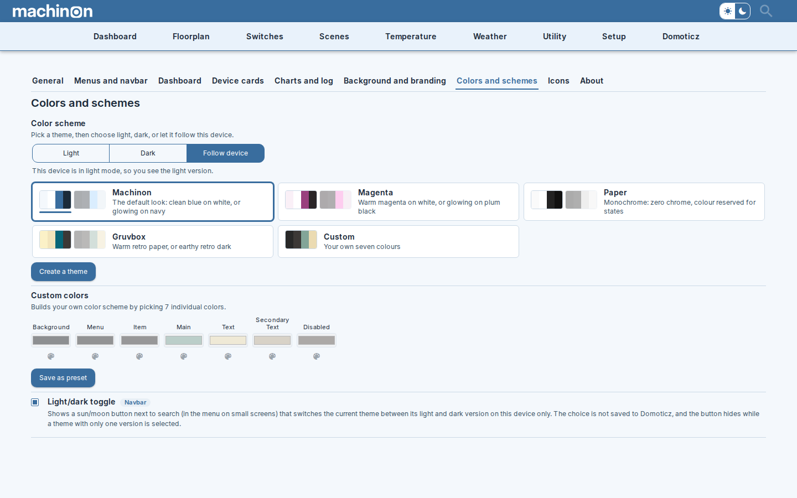{ width="1440" height="900" loading=lazy }
<figcaption>Follow device on a device in light mode</figcaption>
</figure>

<figure markdown="span">
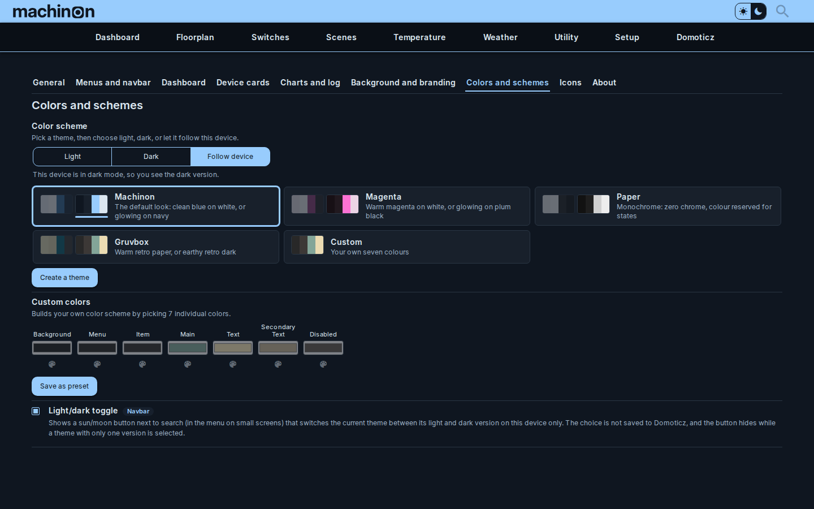{ width="1440" height="900" loading=lazy }
<figcaption>The same choice on a device in dark mode</figcaption>
</figure>

### Themes with a single version

**Custom** (your own seven colors) and presets saved with **Save as preset** have only one
version. While one of them is selected, the Light, Dark and Follow device switch is greyed out
with a note saying the theme has a single version, and the light/dark switch in the header is
hidden, because there is nothing to switch to. Your mode is kept: pick a theme with both versions
again and it applies as before.

## The built-in themes

In the Theme Hub, each theme below is one card holding both of its versions. Machinon is the
default.

| Theme | Version | Description |
| --- | --- | --- |
| Machinon | Light | The default look: clean blue on white |
| Machinon | Dark | The default look: blue glowing on navy |
| Magenta | Light | Warm magenta on white |
| Magenta | Dark | Magenta glow on plum black |
| Paper | Light | Monochrome paper: zero-chrome interface, colour reserved for states |
| Paper | Dark | Ink on slate: the monochrome pair of Paper Light |
| Gruvbox | Light | Warm retro paper |
| Gruvbox | Dark | Retro warm dark with earthy accents |

## The light/dark switch

The sun and moon switch flips the screen between the light and the dark version of your theme,
on the device you tap it on. The half that is filled in shows which version is on screen.

- **On a computer or tablet** (980 pixels wide or more) it sits in the header, next to the search
  box.
- **On a phone or a narrow window** it is in the menu: open the menu and it is at the top right,
  on the row with the close button.

A tap changes only what this device shows. Nothing is saved to Domoticz, your mode in the Theme
Hub stays as it was, and your other devices and other users keep their colors.

How long a tap lasts depends on your mode:

- In **Follow device**, until the device itself next switches between light and dark. From then
  on Machinon follows the device again.
- In **Light** or **Dark**, until you tap again. It is remembered in this browser, so reloading
  the page keeps it.
- Choosing a mode in the Theme Hub always ends it.

While a tap is in effect, the Colors and schemes tab says so, for example "On this device you
switched to Dark with the toggle.", with a button to go back to your mode.

One limit to know about: Machinon only notices the device switching while a Machinon page is
open. If the device switches twice while no page is open, say to dark in the evening and back
to light the next morning, it looks as if nothing changed, so a tap from the evening before
still applies. Tap the switch again, or use the button on the Colors and schemes tab.

The switch is on by default. To remove it, turn off **Light/dark toggle** on the Colors and
schemes tab; it disappears at once, without a reload.

<figure markdown="span">
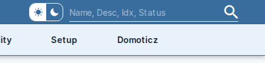{ width="436" height="104" loading=lazy }
<figcaption>Light version on screen</figcaption>
</figure>

<figure markdown="span">
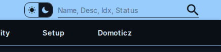{ width="436" height="104" loading=lazy }
<figcaption>Dark version on screen</figcaption>
</figure>

For the switch in the phone menu, see [Mobile layouts](mobile.md#the-lightdark-switch-in-the-menu).

## Opening pages in the right colors

Machinon remembers in each browser which colors it last showed, so from the second visit on,
pages open straight in your theme, dark versions included, with no white flash while the page
loads. The very first visit from a new browser, or after clearing the browser's site data, can
show the default light colors for a moment before your theme appears.

What is remembered belongs to the browser, not to your Domoticz login. If two people with
different themes take turns in the same browser, the page can open in the previous person's
colors for a moment before switching to yours.

## What each scheme looks like

Every screenshot is the same dashboard, so you can compare palettes rather than
layouts. Click any one to see it full size.

<figure markdown="span">
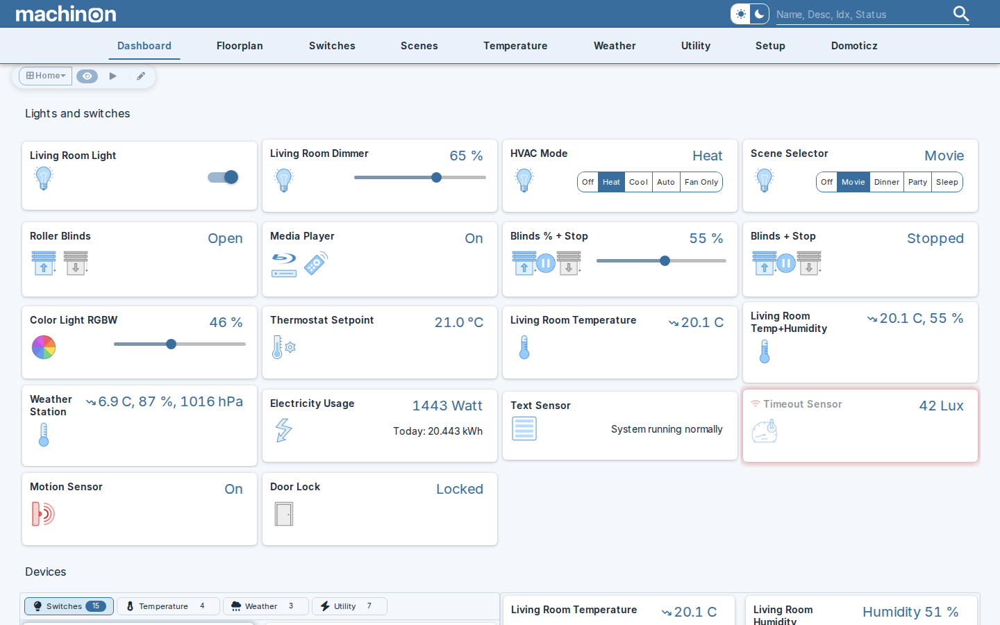{ width="1440" height="900" loading=lazy }
<figcaption>Machinon Light</figcaption>
</figure>

<figure markdown="span">
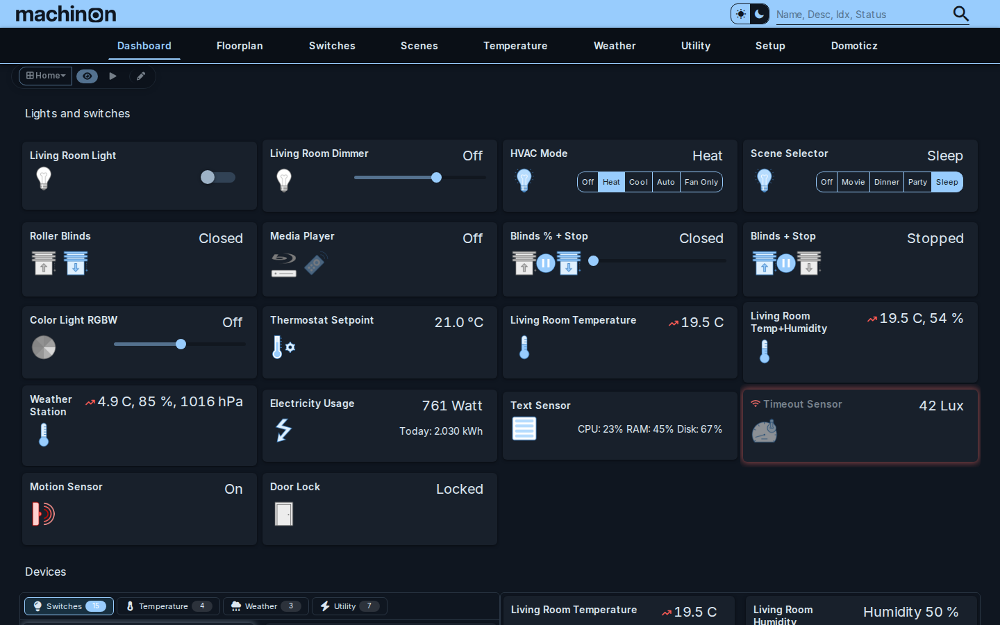{ width="1440" height="900" loading=lazy }
<figcaption>Machinon Dark</figcaption>
</figure>

<figure markdown="span">
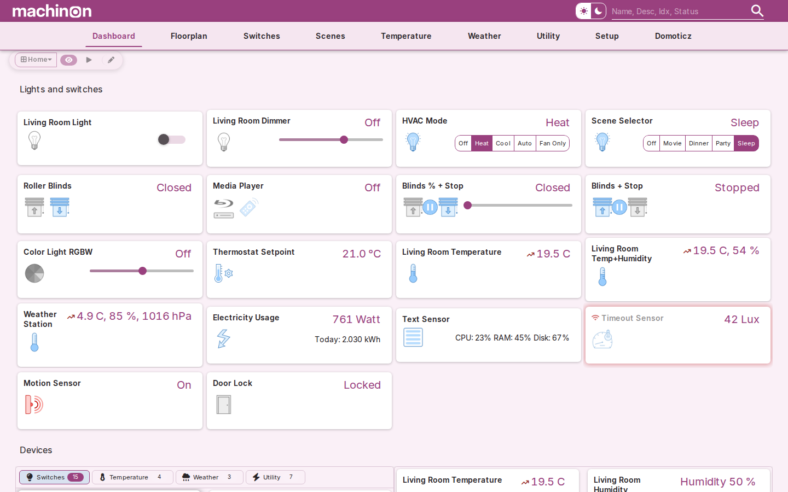{ width="1440" height="900" loading=lazy }
<figcaption>Magenta Light</figcaption>
</figure>

<figure markdown="span">
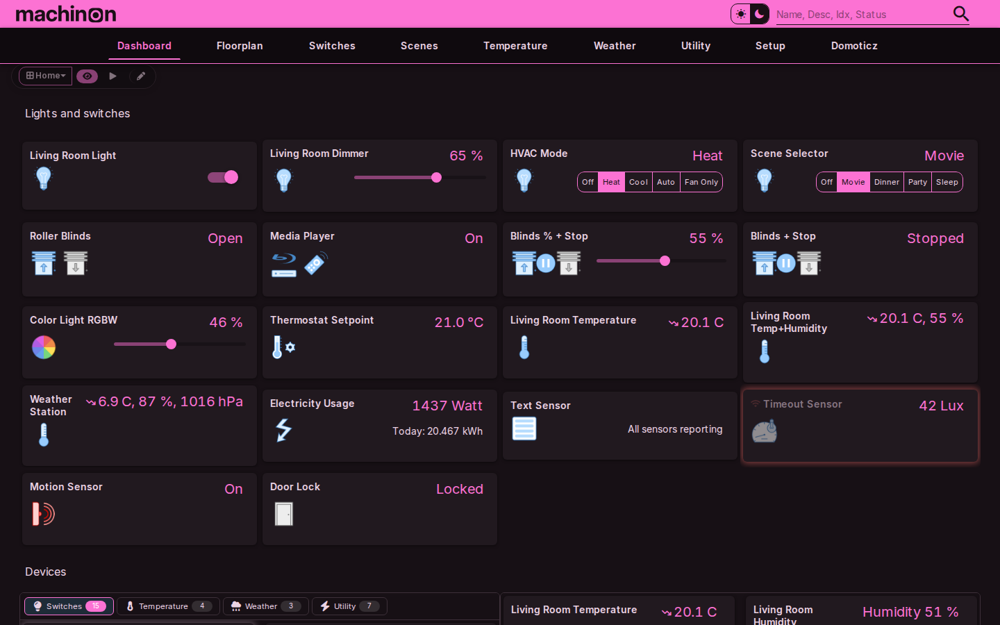{ width="1440" height="900" loading=lazy }
<figcaption>Magenta Dark</figcaption>
</figure>

<figure markdown="span">
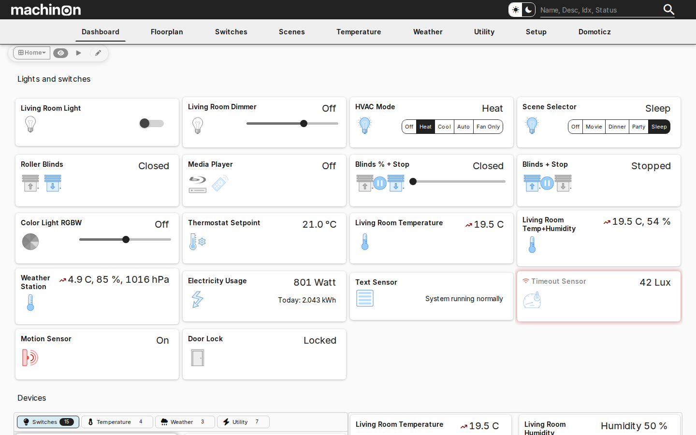{ width="1440" height="900" loading=lazy }
<figcaption>Paper Light</figcaption>
</figure>

<figure markdown="span">
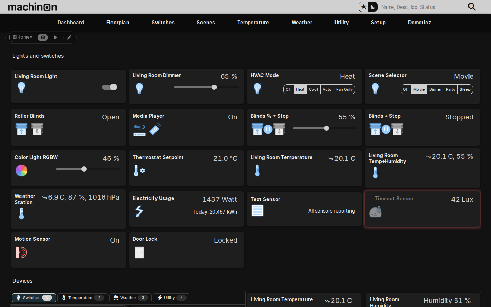{ width="1440" height="900" loading=lazy }
<figcaption>Paper Dark</figcaption>
</figure>

<figure markdown="span">
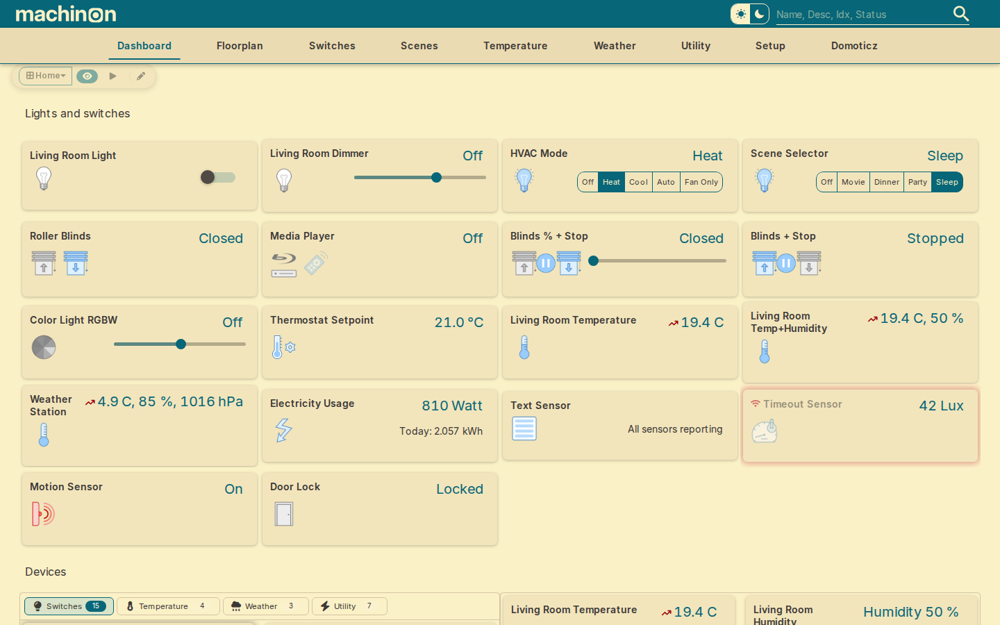{ width="1440" height="900" loading=lazy }
<figcaption>Gruvbox Light</figcaption>
</figure>

<figure markdown="span">
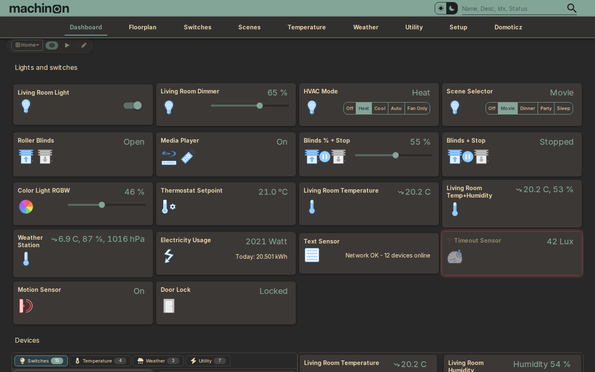{ width="1440" height="900" loading=lazy }
<figcaption>Gruvbox Dark</figcaption>
</figure>

## Building your own colors

There are two ways to build a palette of your own. The theme wizard is the fast route: give it
one or two colors and a look you like, and it builds a finished theme with a light and a dark
version for you. The
manual color editor is the slow route: every one of the seven swatches is yours to set by hand,
for when you already know exactly what you want. Neither one replaces the other, pick whichever
fits the moment.

### The fast way: the theme wizard

On the **Colors and schemes** tab, click **Create a theme**. A three-step dialog walks you
through it:

1. **Pick a color.** This becomes the theme's accent: buttons, links, and anything else that
   should draw the eye. You can also turn on a second color to tint the grays with, so the
   background and card surfaces pick up a hint of it. Only the second color's hue is used, not
   the exact shade, so it always blends in rather than clashing.
2. **Pick a look.** Three options, each showing you a live preview:

   | Look | What it looks like |
   | --- | --- |
   | Crisp | White cards on a light grey page, with edges you can see |
   | Soft | Tinted greys, with cards that barely lift off the page |
   | Deep | A richly tinted page with cards floating above it, and a near-black dark variant |

3. **Name it**, then click **Save theme**.

Behind the scenes, the wizard builds a full light theme and a full dark theme from your choices
and checks every color it generates for readability, so text stays easy to read wherever it
lands. The new theme is added to the picker as one card holding both versions, and is applied
right away in the version your mode asks for, so it works with Light, Dark and Follow device and
with the light/dark switch like the built-in themes.

To delete a theme you made this way, click the small "x" on its card. That removes both its light
and its dark version.

A saved theme is personal, the same as any other theme pick: it follows the account that saved
it, and other people on the same Domoticz don't see them. You don't need admin rights to
create one. That's different from installing an icon, which changes the icon library for everyone
and is an administrator action (see [Icons](icons.md)). If your installation has no separate
logins, Domoticz can't tell users apart, so themes created there are shared like every other
setting; see [Theme Hub](theme-hub.md#personal-settings-versus-shared-settings).

<figure markdown="span">
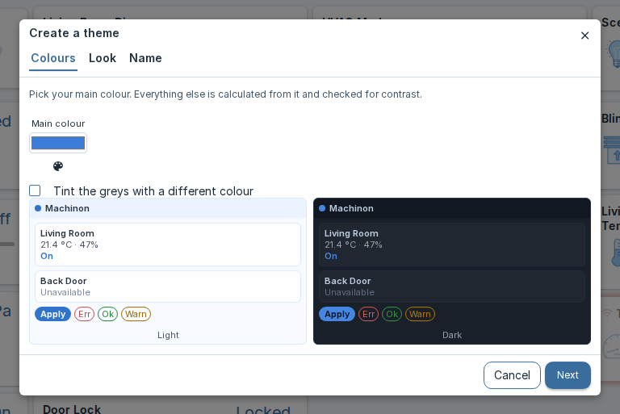{ width="768" height="513" loading=lazy }
<figcaption>1. Pick a color</figcaption>
</figure>

<figure markdown="span">
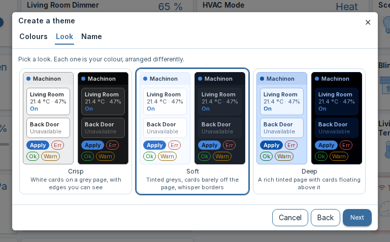{ width="768" height="477" loading=lazy }
<figcaption>2. Pick a look</figcaption>
</figure>

<figure markdown="span">
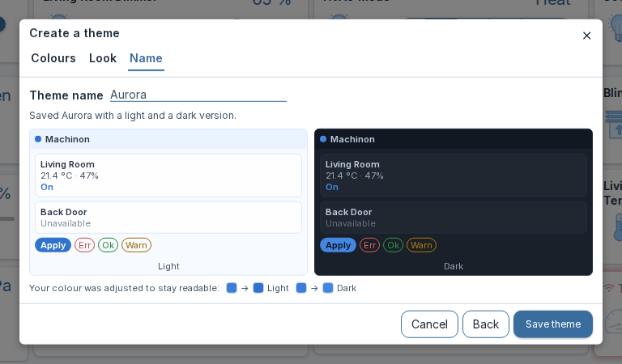{ width="768" height="450" loading=lazy }
<figcaption>3. Name it</figcaption>
</figure>

### Full creative control: the manual color editor

Click the **Custom** card to switch to your own palette. Once it's
selected, seven color swatches become editable. Each one paints a specific part of the
interface:

| Swatch | What it paints |
| --- | --- |
| Background | The page background behind everything else. |
| Menu | The top navigation bar, and any floating menu or dropdown that opens from it. |
| Item | The surface of cards and panels, the base color a device card sits on. |
| Main | The accent color: buttons, links, active states, and anything else that should draw the eye. |
| Text | The main body text color. |
| Secondary Text | Text that's meant to read as less prominent, such as labels and timestamps. |
| Disabled | Controls and text in a disabled or unavailable state. |

Click any swatch to change it. Alongside your browser's own color picker, Machinon offers a
color wheel and a box for typing a hex value directly, useful if you already know the exact
color you want or your browser's built-in picker is a limited one. The same wheel and hex box
are also available in the wizard's color step. Changes apply immediately, so you can see the
result as you go.

#### Saving a custom palette as a preset

Once you're happy with a custom palette, click **Save as preset** and give it a name. It's added
to the picker as its own card, with a small "x" you can click to delete it later. A preset has a
single version, the colors you saved, so the mode switch and the light/dark switch don't apply to
it (see [Themes with a single version](#themes-with-a-single-version)); for a theme with both
versions, use the theme wizard. Saved presets are personal, the same as a built-in theme pick:
they follow the account that saved them.

## The contrast warning

Every scheme that ships with Machinon, and every scheme the theme wizard generates, holds body
text against its background at a comfortable reading contrast, and text on accent-colored
surfaces (like the text on a colored button) at a comfortable minimum too. Those are the same
minimums accessibility guidelines recommend for reading comfort, and the wizard checks its own
output against them before it ever shows you the result.

A palette you build swatch by swatch in the manual editor can't be checked before you pick it,
so Machinon checks it for you instead: every time you change a custom swatch, or save one as a
preset, it re-checks all three pairs and shows a toast naming which pair failed and by how much
if any of them fall short. The color is still applied, and the preset still saves, the check
warns rather than blocking you, so you stay in control of the trade-off, you're just never left
guessing that you made it.
