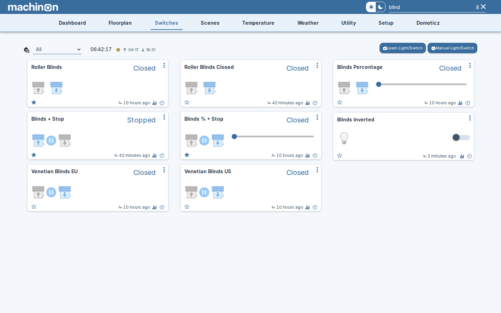
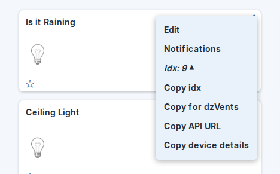

# Finding devices

Once you have more than a screenful of devices, scrolling stops being a good way to reach the
one you want. Machinon puts a search box in the top right of the header, next to the logo. Type
into it and the page narrows to the devices that match, live, as you type.



## Where you can search

The search box works on the pages that show devices as cards:

- **Dashboard** (on a computer; see [On a phone](#on-a-phone) below)
- **Switches**
- **Scenes**
- **Temperature**
- **Weather**
- **Utility**

On every other page there is nothing to filter, so the box dims and the typing area disappears,
leaving just the magnifier, which does nothing when clicked or tapped. That includes the Floorplan page, the Theme Hub, the Domoticz setup
pages, and [Problem devices](problem-devices.md), which is a list rather than a page of cards.

## What a search matches

A device matches if what you typed appears anywhere in:

- its **name**
- its **description**
- its **number**, the index Domoticz gives every device
- its **type**, such as Blinds or Temperature
- the **hardware** it comes from, as named on the Domoticz hardware page

Some pages match a little more: on Temperature and Weather the humidity description and the
forecast text count too, and on Switches a dimmer's percentage counts.

The box's placeholder text reads "Name, Desc, Idx, Status", which undersells it. Searching for
a device type or for the hardware a device belongs to works just as well, and is often the
fastest way to pull a whole family of devices onto one screen. Searching for `blind` on the
Switches page, as in the screenshot above, finds every blind whether or not the word appears in
its name.

## Searching for more than one word

On the Switches, Scenes, Temperature, Weather and Utility pages, and on the Dynamic Dashboard,
several words are treated as separate requirements that can appear **in any order**. Searching
for `living lamp` finds a device called "Living Room Floor Lamp", and so does `lamp living`.
You do not have to remember how the name was written.

The classic **Dashboard** is the exception. Domoticz searches that page itself rather than
handing it to the theme, and it looks for what you typed as **one phrase**. On the dashboard,
`living` finds everything in the living room, but `living lamp` finds nothing, because no device
is called exactly that. If a dashboard search comes up empty, try a single word.

## The match count, and clearing the search

While a search is active, the magnifier is replaced by two things: the number of matches, and a
**×** to clear the search. The number counts the cards on screen rather than distinct devices,
which matters on the classic dashboard, where one device can appear in two sections at once. A
weather station that shows up under both Temperature and Weather counts as two.

You can clear a search in three ways: click the count or the **×**, press Escape while the
box has focus, or simply delete what you typed.

Two shortcuts save reaching for the mouse: F3 or Ctrl+F anywhere on a searchable page jumps
straight into the search box (on other pages they open your browser's own find bar), and Enter
closes the on-screen keyboard on a touch device without clearing what you typed.

## The search stays as you move around

Moving to another page keeps your search term. If you search for `kitchen` on Switches and then
open Temperature, you are still looking at the kitchen. This is deliberate: walking one room's
devices across several pages is the common case, and having to retype the room on each page was
the old, slower behaviour.

The flip side is that a page can look emptier than it should because a search you forgot about
is still running. If devices are missing, check the search box first. On every searchable page
the count beside it stays visible while a search is active, including on a phone, precisely so
you can spot this. Pages with nothing to search show only the dimmed magnifier; the search picks
up again on the next page that has one.

## Cameras on the dashboard

The camera previews on the classic dashboard are searched too, by camera name. Typing part of a
camera's name keeps that camera and hides the others. If nothing matches, the whole Cameras
section disappears rather than sitting empty above a filtered dashboard.

## On a phone

The box collapses to a magnifier in the header to save space, and expands into a floating field
when you tap it, with the keyboard already up so you can start typing straight away. Once you
have searched, the magnifier turns into the number of matches: tap that number to reopen the
field with your search in it, then tap the X to clear it. See [Mobile layouts](mobile.md) for
how the header behaves on small screens.

One difference worth knowing: the **Dashboard** is not searchable on a phone, because the phone
dashboard is a different, compact layout rather than the card grid the search filters. Switches,
Scenes, Temperature, Weather and Utility all search normally on a phone.

## Copying a device's details

Every device card's menu (the three dots in its top right corner) ends with the device's
number, its idx, for example **Idx: 16**. Click it to open four copy actions underneath. The menu
is on the same pages as the search: the Dashboard on a computer, Switches, Scenes, Temperature,
Weather and Utility.



| Action | What it copies | For example |
|---|---|---|
| **Copy idx** | just the number | `16` |
| **Copy for dzVents** | a line to paste into a dzVents script, with the name as a comment | `domoticz.devices(16) -- Possible Rain` |
| **Copy API URL** | the address that reads this device through the Domoticz JSON API | `http://192.168.1.10:8080/json.htm?type=command&param=getdevices&rid=16` |
| **Copy device details** | a short block of facts to paste into a forum or GitHub post | see below |

The device details look like this, one line per fact the device has:

```text
Device: HVAC Mode (idx 90)
Type: Light/Switch, Selector Switch, Selector
Hardware: Dummy
Hardware type: Dummy (Does nothing, use for virtual switches only)
Device ID / unit: 000140AA / 1
Value: Auto
Last update: 2026-10-15 09:00:00
Domoticz 2026.4 (build 18468), Machinon 2.7.3
```

The details are always in English, whatever language Domoticz is set to, because they are meant
for the people reading your support post.

After a copy, the row briefly reads **Copied**. If your browser refuses to copy, a small text box
opens in the menu instead, with the text already selected: copy it from there yourself (Ctrl+C,
Cmd+C on a Mac, or press and hold on a phone). None of these actions changes anything on the
device.

On a **scene** or **group** card the actions follow suit: the dzVents line uses
`domoticz.scenes(...)` or `domoticz.groups(...)`, and the API address reads the scene
(`param=getscenes`). Scenes and groups are numbered separately from devices, so a scene and a
device can share a number.

The API address is built from the address you are browsing Domoticz on, so it works from the same
place. It never includes a user name or password, even if your browser's address bar has one in
it. If Domoticz asks for a login, the address needs the same login when you use it elsewhere.

## See also

Searching narrows a page to what you typed. There is a second way to narrow a page, aimed at a
specific set of devices rather than a word: a warning about a timed-out sensor or a low battery
can filter the page to just the devices it names. See
[Problem devices](problem-devices.md).
